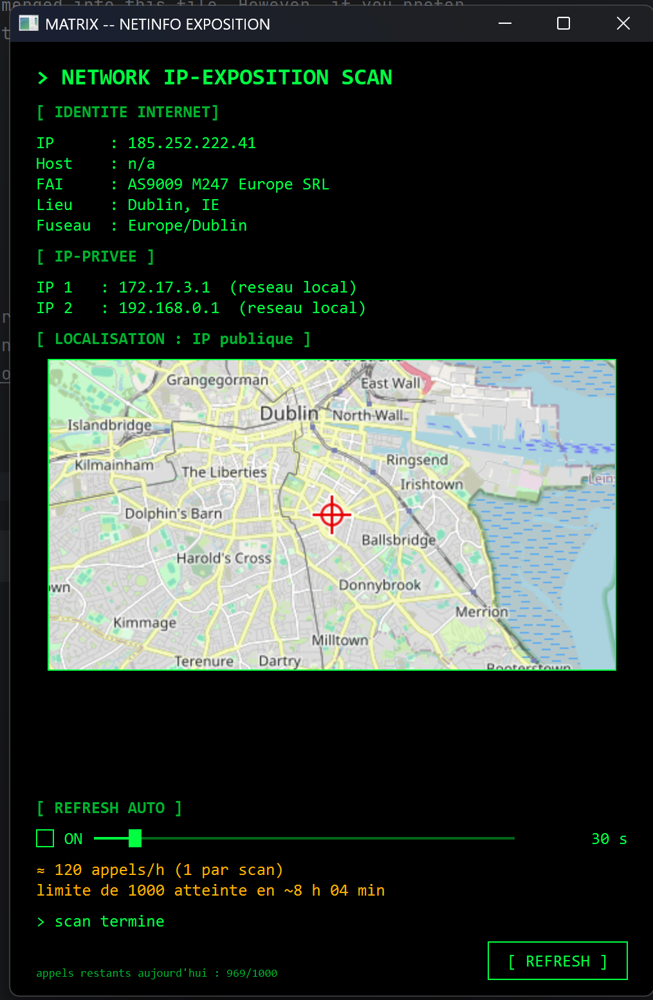

# Description

Visualiser rapidement son adresse ip exposée sur internet

Application faite en prompt enginering en python



## Pré requis:
Connaissance en langage python et manipulation des IDE
version python : 3.12

Installation des librairies du projet dans le fichier requierement.txt
ou lancer les commande `pip install Pyside6 requests`

## Exécution:
Lancer la commande python main.py


# Matrix NetInfo : structure du projet

## Arborescence

```
├── main.py           # point d'entrée
├── main_window.py    # interface graphique uniquement
├── worker.py         # thread qui orchestre les recherches
├── local_lookup.py   # recherche locale
├── dns_lookup.py     # définition de l'adresse DNS / IP (via Internet)
├── map_builder.py    # construction de la carte
├── config.py         # toutes les constantes
├── styles.py         # feuille de style Matrix (QSS)
├── quota.py          # compteur d'appels par jour et calcul des appels/heure
├── utils.py          # fonctions d'affichage (durées)
```

## Rôle de chaque fichier

| Fichier | Rôle |
|---|---|
| `local_lookup.py` | Tout ce que la machine sait d'elle-même, sans Internet. Il lit les serveurs DNS configurés (Windows, macOS, Linux), indique si une adresse est locale ou publique, et fait la résolution DNS inverse. |
| `dns_lookup.py` | La définition de l'adresse DNS. Avec `requests`, il identifie ton IP publique, décrit chaque serveur DNS (opérateur, lieu, coordonnées) et choisit le point à afficher sur la carte. Il ne dépend pas de Qt. |
| `main_window.py` | La partie graphique seule, sans aucune logique réseau. Elle affiche les résultats que lui envoie le worker. |
| `worker.py` | Le lien entre les deux mondes. Il appelle les recherches dans un `QThread` pour que la fenêtre ne se fige pas. |
| `map_builder.py` | Téléchargement des tuiles, filtre vert optionnel et marqueur. Isolé car il utilise Qt pour dessiner, mais ce n'est pas de l'interface. |
| `config.py` | Couleurs, taille de fenêtre, URL, délai d'attente, zoom et taille de la carte. Pour changer le zoom, la taille de la carte ou le vert, tout se fait ici. |
| `styles.py` | Le style Qt, construit à partir des valeurs de `config.py`. |
| `quota.py` | Compteur local d'appels `ipinfo.io`, remis à zéro chaque jour et enregistré dans `~/.matrix_netinfo/quota.json`. Calcule aussi le nombre d'appels par heure selon l'intervalle de rafraîchissement. |
| `utils.py` | Mise en forme des durées (`30 s`, `5 min`, `4 h 10 min`). |# QT_IP_display
